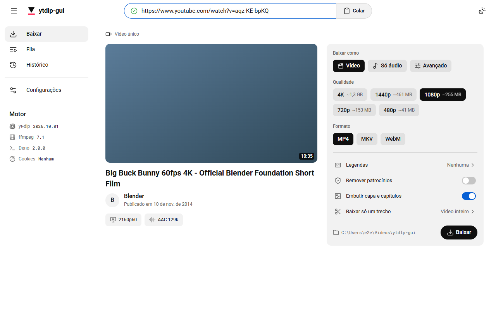
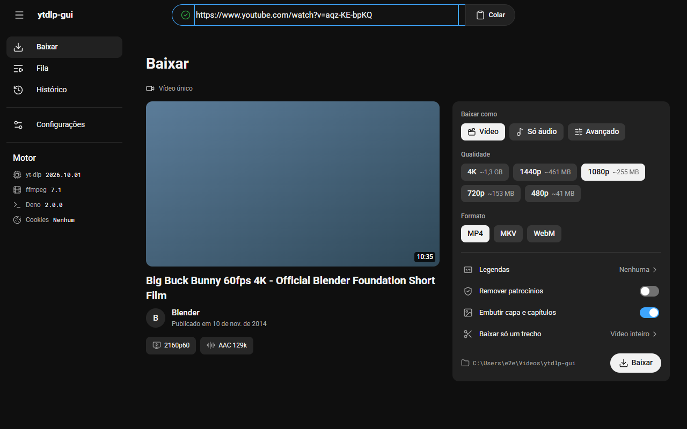
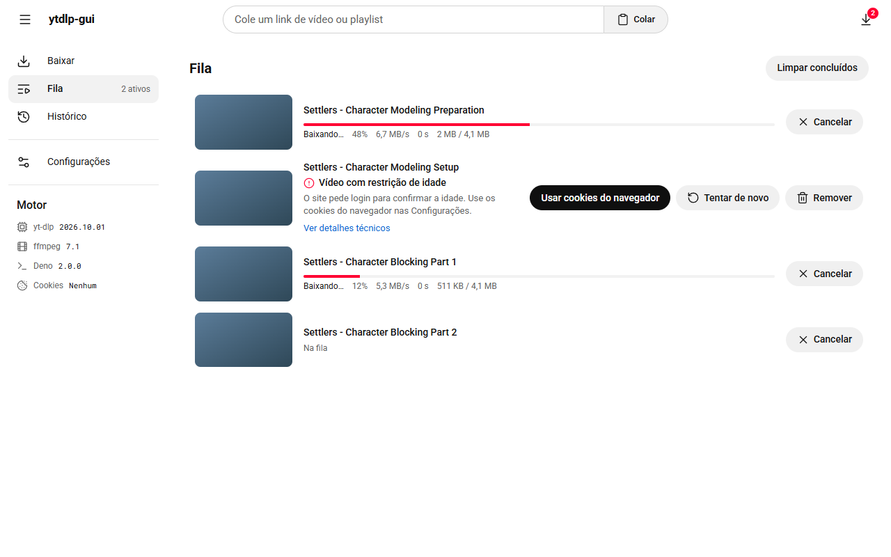
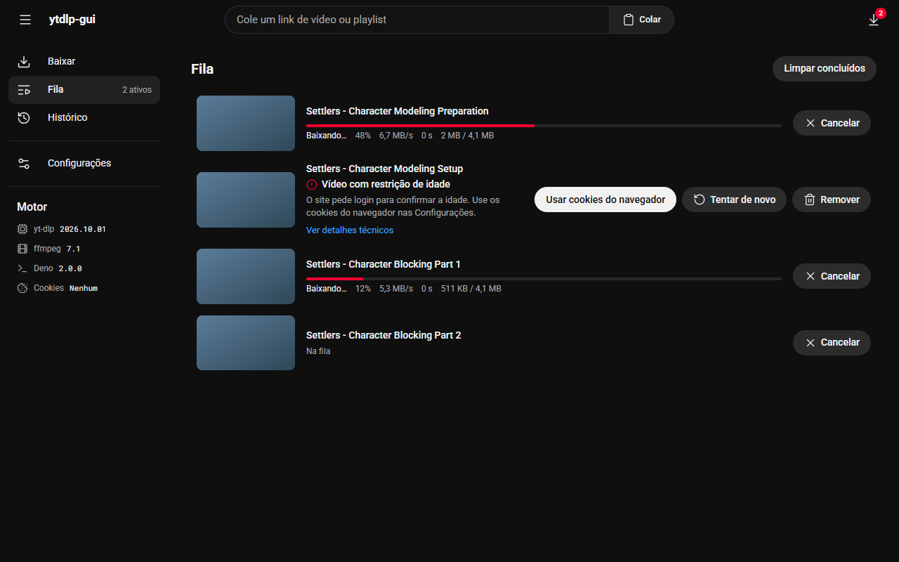

# ytdlp-gui

[Português (Brasil)](README.pt-BR.md)

A simple, friendly desktop interface for [yt-dlp](https://github.com/yt-dlp/yt-dlp). Paste a link, pick a quality, download. Built with Tauri 2, React and TypeScript.

> `ytdlp-gui` is a working title.

| Light | Dark |
| --- | --- |
|  |  |
|  |  |

## Features

- Paste a video or playlist link and see its details before downloading.
- Choose quality and format with plain-language options; select the playlist items you want.
- A download queue with progress, cancel and retry, plus a history of finished downloads.
- Friendly error messages with a suggested fix (for example, "use Firefox cookies").
- Installs yt-dlp, ffmpeg and Deno for you on first run (with checksum verification) and keeps yt-dlp up to date.
- Light and dark themes; English and Brazilian Portuguese.
- In-app updates, signed with the Tauri updater key. The app only installs an update after you agree.

## Install

Download the installer for your system from the [latest release](https://github.com/mateuso12/ytdlp-gui/releases/latest).

| System | File |
| --- | --- |
| Windows | `.msi` or `.exe` |
| macOS (Apple silicon and Intel) | `.dmg` |
| Linux | `.AppImage`, `.deb` or `.rpm` |

### The app is not code-signed yet

Version 1 ships without a code-signing certificate, so your system warns you the first time you open it.

- **Windows (SmartScreen):** click **More info**, then **Run anyway**.
- **macOS (Gatekeeper):** the app is only ad-hoc signed, so macOS may refuse to open it. Try **System Settings**, then **Privacy & Security**, and click **Open Anyway** next to the blocked app. If that does not work, the most reliable fallback is to remove the quarantine flag in Terminal: `xattr -dr com.apple.quarantine /Applications/ytdlp-gui.app`.
- **Windows Smart App Control:** if Smart App Control is on, Windows blocks unsigned apps entirely and there is no "Run anyway" button. Either [build from source](CONTRIBUTING.md#local-setup) or wait for a signed release. Windows code signing through the SignPath Foundation is planned (see [docs/signing.md](docs/signing.md)).

## Responsible use

You are responsible for respecting copyright and the terms of service of each site you download from. Use this tool only for content you have the right to download.

## Credits

Made possible by free software: [yt-dlp](https://github.com/yt-dlp/yt-dlp) (Unlicense), [FFmpeg](https://github.com/FFmpeg/FFmpeg) (LGPL/GPL), [Deno](https://github.com/denoland/deno) (MIT), [Tauri](https://tauri.app) and [React](https://react.dev).

## Contributing

See [CONTRIBUTING.md](CONTRIBUTING.md) and [docs/translating.md](docs/translating.md).

## License

[MIT](LICENSE) © Mateus Amaro
